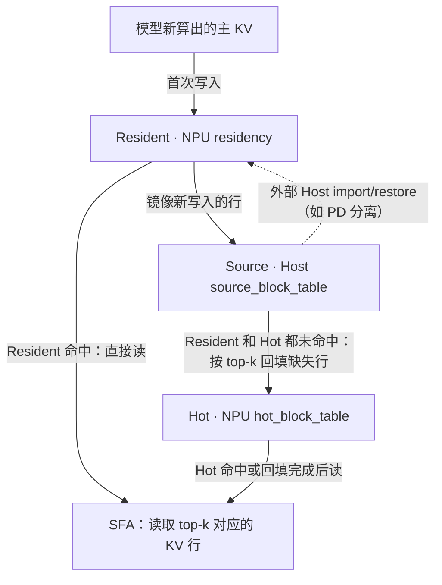
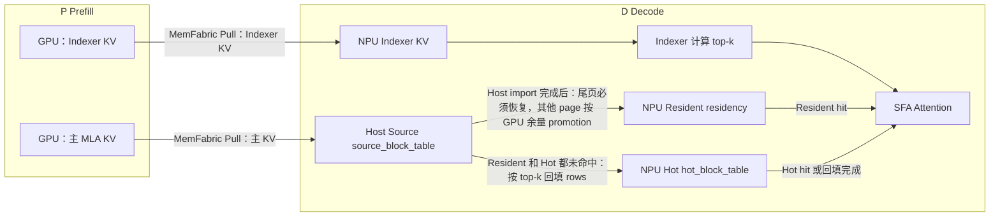

https://docs.vllm.ai/en/v0.30.0/design/hisparse/

vllm/vllm:docs/design/hisparse.md

针对稀疏注意力模型（如DSA）的KVCache offload。

主要针对decode优化：

| decode | prefill |
| -------------- | --------------- |
| 历史 KV 很大，但每一步实际读取的 KV 很少 | 一次处理大量 Query，不能直接把整个请求的工作集压成一份很小的 Top‑k。 |
| 连续decode具有时间局部性 | |
| 历史KV | KV是刚刚在GPU中产生的 |

index cache仍然全部存在HBM

节省的容量可以换取更大的decode并发。

# HiSparse

问题：使用稀疏注意力后，计算量减了，但decode节点仍然保存大量KV。

稀疏注意力在解码时只读取 Top-K 个 token 的 KV，其实没必要把完整的 KV 历史都留在宝贵的 GPU 显存（HBM）里，可以将完整历史放在 CPU Host Memory，GPU 只保留一个小型的“热”缓存，按需取用。

### 主要组件与工作方式

HiSparse 不是一个单一的模块，而是集成在 vLLM 调度器和 Worker 中的一套协作机制：

*   **`HiSparseCoordinator`**：运行在调度器侧，负责管理主机端的逻辑块、跟踪前缀身份，并决定 GPU 块的驻留与迁移。
*   **`HiSparseConnector`**：作为 KV 连接器，负责在调度器和 Worker 之间传递数据迁移的指令和状态。
*   **`HiSparseWorker` & `HiSparseRuntime`**：运行在 Worker 侧，负责执行实际的数据传输，并管理每个注意力缓存对应的主机/GPU 视图。

在具体实现上，它还会利用 **LRU（最近最少使用）** 策略来管理 GPU 上的热缓存，以提高 Top-K 数据的命中率；并通过融合 CUDA 内核来处理命中、未命中以及从主机取数的操作，力求不让数据搬运阻塞解码的关键路径。

## Source、Resident、Hot：BlockTable 与 KV 流向

BlockTable 只负责定位，不存 KV 数据。

普通本地 Decode 的主流程是 Resident → Source 镜像和 Source → Hot 按行回填。虚线表示外部 Host import 后的按页恢复路径，当前 PD 分离是主要实例。

PD 分离下，P 端产生 Prefill KV，D 端接收后继续 Decode

