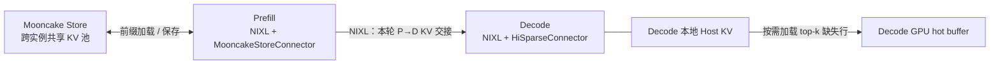

https://github.com/PrimeIntellect-ai/prime-rl/pull/4023

## 如果优先要“完整共享池”，先不叠 HiSparse

vLLM 官方完整方案是：

- `MooncakeConnector`：P→D 点对点传输。
- `MooncakeStoreConnector`：跨实例共享 KV。
- `MultiConnector`：组合两者。
- D 可用 `save_decode_cache=true`，将生成阶段完成的 KV blocks 写入池，供后续请求复用。

[官方指南](https://docs.vllm.ai/en/latest/features/mooncake_store_connector_usage/#disaggregated-prefill-decode-xpyd) 给出了 master、Store 配置、P/D 命令和代理入口。
