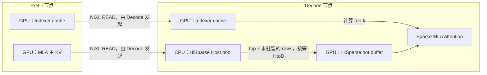

内存的流向  D  H RH（Rmote Host）  RD（Remote Device），分
- main
- index

池化

- D -> D 保证基础配置OK
- D -> RH

叠加池化后，kvcache是怎么流动的
- 只给Prefill池化？

先对齐社区

PD不对等？

## vLLM PD分离 + HiSparse
### 1. 纯 NIXL + pull

 ```bash
"$HOME/ai-infra-dev/code/vllm-workspace/vllm/.venv/bin/python" dev vllm serve \
  --script glm-5.3-nixl-pd-pull.py \
  --devices "$P_GPU_UUID,$D_GPU_UUID"
 ```

### 2. 纯 NIXL + push

 ```bash
"$HOME/ai-infra-dev/code/vllm-workspace/vllm/.venv/bin/python" dev vllm serve \
  --script glm-5.3-nixl-pd-push.py \
  --devices "$P_GPU_UUID,$D_GPU_UUID"
 ```

### 3. HiSparse + NIXL pull

 ```bash
"$HOME/ai-infra-dev/code/vllm-workspace/vllm/.venv/bin/python" dev vllm serve \
  --script glm-5.3-hisparse-pd.py \
  --devices "$P_GPU_UUID,$D_GPU_UUID"
 ```

### 4. HiSparse + NIXL push

 ```bash
"$HOME/ai-infra-dev/code/vllm-workspace/vllm/.venv/bin/python" dev vllm serve \
  --script glm-5.3-hisparse-pd-push.py \
  --devices "$P_GPU_UUID,$D_GPU_UUID"
 ```

 第 4 个命令当前预期在 Decode 初始化时报错：

 ```text
NotImplementedError:
NixlPushConnector does not support mixed-memory KV caches
 ```

./hisparse-nixl-push-failed.log

## PD分离(nixl pull) + HiSparse中的KVCache传输


| 传输内容 | P 侧源位置 | Decode 侧目标位置 | 数据方向 |
|---|---|---|---|
| **MLA 主 KV** | P GPU 显存 | Decode 的 HiSparse Host pool | **Device → 对端 Host** |
| **Indexer cache** | P GPU 显存 | Decode GPU 显存 | **Device → 对端 Device** |




**不是先把全部主 KV 拉到 Decode 显存，再由 HiSparse 卸载到 Host。** NIXL 的主 KV 接收目标直接就是 HiSparse Host pool；随后计算时，HiSparse 再把所需且未驻留的 rows 搬进 GPU hot buffer。

1. 主 KV 与 Indexer 分组，放置不同。   vllm/v1/hisparse/layout.py #L147
  - Indexer group：参与 KV transfer，保留在 GPU。
  - 主 KV source group：`host_resident=True`、`enable_kv_transfer=True`。
  - GPU resident / hot groups：`enable_kv_transfer=False`，不是 P→D 的传输目标。

2. **NIXL 按 tensor 的真实位置注册内存。**  
   [`base_worker.py:1707`](vllm/distributed/kv_transfer/kv_connector/v1/nixl/base_worker.py#L1707)：
   ```python
   if cache.device.type == "cpu":
       mem_type = "DRAM"
   else:
       mem_type = self.nixl_memory_type
   ```
   因此 Decode 同时注册 Host 主 KV 和 GPU Indexer cache，形成 mixed-memory 接收端。

3. **Pull 路径把一次请求拆为 DRAM 和 Device 两类 READ。**  
   [`NixlPullConnectorWorker._read_blocks_mixed()`](vllm/distributed/kv_transfer/kv_connector/v1/nixl/pull_worker.py#L651) 按 descriptor 类型拆分，分别向本地 DRAM handle、Device handle 提交 `"READ"`。

4. **Decode 计算时再从 Host 补入 hot buffer。**  
   [`HiSparseRuntime._swap_rows()`](vllm/v1/hisparse/runtime.py#L921)：
   ```python
   self.cache_ops.hisparse_gather_compact(
       self.host_cache,
       hot.cache,
       ...
   )
   ```

:::NOTE
 - P→D 交接的是需要传输的完整历史 KV blocks，**不是只传 top-k**；top-k 按需加载发生在 Decode 内部。
 - 上述描述的是 **vLLM/NIXL 注册的源、目标内存位置**；不能据此断言 UCX 底层完全没有 staging/bounce buffer，或一定走某种 GPUDirect 路径。
