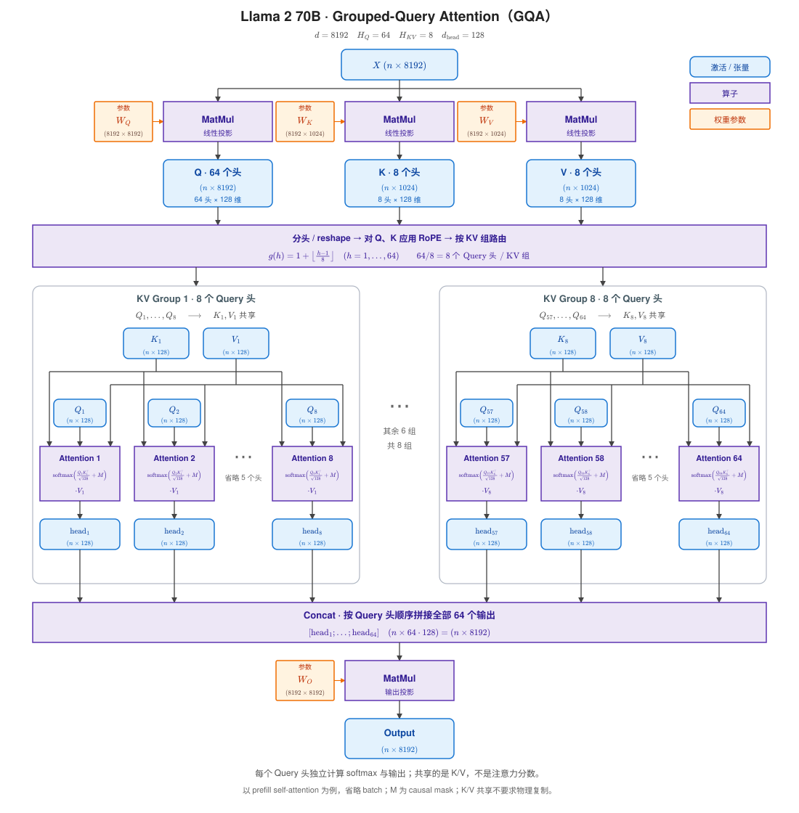

## GQA 相比 MHA 能同时节省投影权重和 KV Cache

GQA算子实现时，要尽量避免物理拷贝$K$和$V$。

### 省投影权重矩阵

GQA 的 K/V 投影层输出维度是 n_kv_heads * $d_{head}$，而不再是 MHA 的 n_heads * $d_{head}$。
64个query头8个KV头，`n_heads=64`，`n_kv_heads=8`，KV的投影参数量减少到原来的1/8。

### 省KV Cache

KV Cache 存储的是推理时每一层、每个 token 经过线性投影矩阵$W_K$、$W_V$后的 $K$ 和 $V$ 张量。

MHA 中，缓存中需要存储 `n_heads=64` 组完整的 K/V。而 GQA 只需缓存 `n_kv_heads=8` 组。

KV Cache 的体积会缩减为 MHA 的 `n_kv_heads / n_heads=1/8`。

GQA和MHA缓存$K$和$V$。KV Cache 的精确形状是
- Llama 2 7B： (max_batch_size, max_seq_len, n_heads=32, $d_{head}=128$)
- Llama 2 70B：(max_batch_size, max_seq_len, n_kv_heads=8, $d_{head}=128$)

| 模型版本 | 注意力头数 (Attention Heads) | KV 头数 (KV Heads) | 每个头维度 ($d_{\text{head}}$) | 备注 |
| :--- | :--- | :--- | :--- | :--- |
| **Llama 2 7B** | **32** | 32 | **128** | 标准多头注意力 (MHA) |
| **Llama 2 13B** | **40** | 40 | **128** | 标准多头注意力 (MHA) |
| **Llama 2 70B** | **64** (Q Heads) | **8** | **128** | 分组查询注意力 (GQA) |

### 并非所有模型结构的KVCache，都缓存$K$和$V$

MLA：缓存的不是 $K$/$V$，而是压缩的“潜向量”
- **压缩存储**：MLA 将每个 token 的 Key 和 Value 信息**联合压缩成一个低秩的“潜向量”（latent vector）**，这个潜向量才是唯一被缓存的内容。MLA 的 KV Cache 大小可以缩减到标准 MHA 的约 **1/10**。
- **动态重建**：在推理需要计算注意力时，MLA 会从这个缓存的潜向量中**实时（on the fly）解压、重建**出各个头的 K 和 V。
- **与 GQA 的本质区别**：GQA 是**共享**已投影的 K/V 头；MLA 是**压缩** K/V 的内容本身，存储的是一个更底层的表示。
