# vLLM DCP + MLA：KV Cache Layout、Prefill 与 Decode

> 范围：dense MLA，基础 DCP（`PCP=1`）。DCP 复用 TP ranks，沿 sequence 维度切分 KV cache；MLA cache 保存压缩 latent，而不是展开后的每-head K/V。



## 1. MLA cache 是什么

MLA 的逻辑张量：

| 张量 | 形状 | 含义 |
|---|---:|---|
| `q_nope` | `[Sq, N, P]` | query 的非 RoPE 部分 |
| `q_pe` | `[Sq, N, R]` | query 的 RoPE 部分 |
| `kv_c` | `[Skv, Lkv]` | 每 token 的压缩 KV latent |
| `k_pe` | `[Skv, R]` | 每 token 的位置编码部分 |

历史 cache 是：

```text
cache_kv_c: [C, Lkv]
cache_k_pe: [C, R]
```

Prefill 可以把 `kv_c` 投影成多头 `K/V`，追求计算效率；decode 则把 query 吸收到 latent 空间，直接用 `[kv_c, k_pe]` 做类似 MQA 的计算，追求减少内存搬运。

源码：`code/vllm-workspace/vllm/vllm/model_executor/layers/attention/mla_attention.py:25-117`。

物理 cache 仍是 paged cache。Ascend MLA 声明基础形状为：

```text
[num_blocks, block_size, num_kv_heads, head_size]
```

`head_size`、是否把 `kv_c`/`k_pe` 拆成两个 cache、是否量化，由具体 backend 决定。逻辑 `[token, Lkv+R]` 不等于所有 kernel 的物理 stride。

## 2. DCP KV layout：交错分片

设：

```text
D = dcp_size
r = DCP rank
B = physical block_size
I = cp_kv_cache_interleave_size
```

假设 `B % I == 0`。一个虚拟 block 覆盖 `B×D` 个 token。全局位置 `x` 的 owner 和它在该 rank 请求序列中的位置为：

```text
v = x // (B×D)
o = x % (B×D)
target_rank = (o // I) % D
local_position = v×B + (o // (I×D))×I + (o % I)
```

例：`B=4, D=4, I=1`：

| 全局 token | 0 | 1 | 2 | 3 | 4 | 5 | 6 | 7 | 8 | 9 | 10 | 11 |
|---|---:|---:|---:|---:|---:|---:|---:|---:|---:|---:|---:|---:|
| owner rank | 0 | 1 | 2 | 3 | 0 | 1 | 2 | 3 | 0 | 1 | 2 | 3 |
| local slot | 0 | 0 | 0 | 0 | 1 | 1 | 1 | 1 | 2 | 2 | 2 | 2 |

含义：

- 每个 rank 保存每个虚拟 block 的 `B` 个 token；
- public block table 仍以 physical `B` 为单位；
- effective attention block size 是 `B×D`；
- 新 token 追加时，owner 可由位置直接计算，不需搬迁旧 cache。

源码：

- upstream 公式：`vllm/v1/attention/backends/utils.py:1177-1236`；
- Ascend slot mapping：`vllm_ascend/ops/triton/block_table/compute_slot_mappings.py:76-115`；
- Ascend 设计文档的 [KV-cache layout](https://docs.vllm.ai/projects/ascend/en/main/developer_guide/Design_Documents/context_parallel.html#kv-cache-layout)。

## 3. Prefill 流程

一次请求已有历史 `C`，本轮新增 `Sq` 个 token：

```text
hidden
  ├─ q_nope, q_pe
  └─ new_kv_c, new_k_pe
```

### 3.1 写 cache

每个新 token 通过 slot mapping 写入 owner rank：

```text
owner rank     -> 写入本地 paged cache
other ranks    -> PAD_SLOT_ID(-1)，跳过写入
```

Ascend MLA 的 cache 写入最终调用 `reshape_and_cache()`，见 `vllm_ascend/attention/mla_v1.py:1791-1835`。

### 3.2 计算 attention

Prefill 分两路：用本轮新 K/V 做因果 attention；有历史 cache 时，再对历史 KV 做 context attention。两路使用相同的 TP 本地 Q heads，不做 DCP Q all-gather。

```text
TP-local Q + 本轮新 K/V -> current attention

本地历史 paged KV
  └─ DCP all-gather：sequence/token 轴
        └─ reorg：按请求拼接，去除 padding
              └─ kv_c -> W_UK/W_UV -> K/V
                    └─ 与 TP-local Q 做 context attention
```

当前 token 的结果与 context 结果再按 output/LSE 合并。

源码：

- upstream：`vllm/model_executor/layers/attention/mla_attention.py` 的 `forward_mha()`、`_context_parallel_compute_prefill_context()`；
- Ascend：`vllm_ascend/attention/mla_v1.py` 的 `_forward_prefill()`、`_compute_prefill_context()`；DCP 聚合与重排在 `vllm_ascend/attention/context_parallel/mla_cp.py` 的 `_reorg_kvcache()`。

长上下文通常按 workspace 分块：

```text
for each context chunk:
    load paged KV rows
    gather across DCP ranks
    group rows by request and drop padding
    attention(current Q, context chunk)
    merge chunk output + LSE
```

**文档差异：**Ascend 设计文档的 Prefill 配图标了 `DCP.AG Q(head)`，但上述 dense MLA 源码直接使用 TP 本地 Q；此处以源码执行路径为准。

## 4. Decode 流程

每个请求通常只产生 1 个 query token。每个 rank 已有不同的 KV sequence shard。

### 4.1 Q 按 head 聚合

```text
rank r: q_r = [token, N_local, Lkv+R]

DCP all-gather(Q, head axis)
       ↓
Q = [token, N_local×D, Lkv+R]
```

upstream `MLADCPManager._gather_query()` 调用 `group.all_gather(query, dim=1)`；Ascend 对应 `reorg_decode_q()`：

- `vllm/v1/attention/ops/dcp.py`：`MLADCPManager._gather_query()`；
- `vllm_ascend/attention/context_parallel/mla_cp.py`：`AscendMlaDCPImpl.reorg_decode_q()`。

这里画的是 Q all-gather 路径。若 Ascend 已通过复制 Q 投影在每个 rank 生成 DCP 组内所需的 heads，`reorg_decode_q()` 会跳过这次通信。

### 4.2 本地 attention

```text
rank r:
    完整 Q heads
    rank r 的本地 KV shard
    └─ attention -> O_r, LSE_r
```

MLA decode 直接使用压缩 cache，不先复制完整 K/V 到每个 rank。

### 4.3 LSE 合并

不能直接平均 `O_r`。每个 rank 返回：

```text
O_r = local normalized output
L_r = local log-sum-exp
```

全局结果：

$$
M=\max_r L_r,\qquad
w_r=e^{L_r-M},\qquad
O=\frac{\sum_r w_rO_r}{\sum_r w_r}.
$$

通信实现可选：NCCL collective、fused A2A、direct symmetric-memory A2A；数学依赖相同。

upstream 根据配置选择 `dcp_a2a_lse_reduce`、`cp_lse_ag_out_ar` 或 `cp_lse_ag_out_rs`，见 `vllm/v1/attention/ops/dcp.py:1764-1809`。Ascend 使用 `dcp_a2a_fused` / `fused_dcp_lse_combine`，见 `vllm_ascend/attention/context_parallel/common_cp.py:169-191`、`mla_cp.py:764-780`。

## 5. 两条通信路径对比

| 阶段 | 通信对象 | 目的 | 本地计算后的结果 |
|---|---|---|---|
| Dense Prefill（有历史） | 历史 KV，sequence 轴 | 每个 rank 用本地 Q heads 看完整历史 | current/context attention；按 chunk 合并 |
| Decode | Q，head 轴（尚未具备组内 heads 时） | 每个 rank 得到 DCP 组内所需的 query heads | 本地 `O_r/LSE_r` |
| Decode 收尾 | partial output + LSE | 恢复全局 softmax | 每 rank 的 local head output |

核心区别：**Dense Prefill 聚合历史 KV，让本地 Q 看完整上下文；Decode 保留 KV 分片，用 DCP 组内 Q heads 算局部结果，再合并 output/LSE。**

## 6. DCP、TP、PCP 不要混淆

- **TP**：主要分片权重、hidden/head；
- **DCP**：复用现有 ranks，分片 KV 的 sequence；
- **PCP**：增加 prefill ranks，分摊长 prompt 的 query/token 计算；
- **PCP+DCP**：同时维护 local query、global request、DCP-local cache 三种视图，复杂度高于本文基础 DCP。

DCP 不改变 attention 数学结果，只改变：

```text
KV 的拥有者
+ Q/KV 的通信位置
+ partial output/LSE 的合并方式
```

## 7. 资料

- [vLLM Context Parallel Deployment](https://docs.vllm.ai/en/latest/serving/context_parallel_deployment)
- [vLLM Ascend Context Parallel Design](https://docs.vllm.ai/projects/ascend/en/main/developer_guide/Design_Documents/context_parallel.html)
- [vLLM Ascend Context Parallel Guide](https://docs.vllm.ai/projects/ascend/en/main/user_guide/feature_guide/context_parallel.html)
- upstream MLA：`code/vllm-workspace/vllm/vllm/model_executor/layers/attention/mla_attention.py`
- Ascend MLA DCP：`code/vllm-ascend-workspace/vllm-ascend/vllm_ascend/attention/context_parallel/mla_cp.py`
