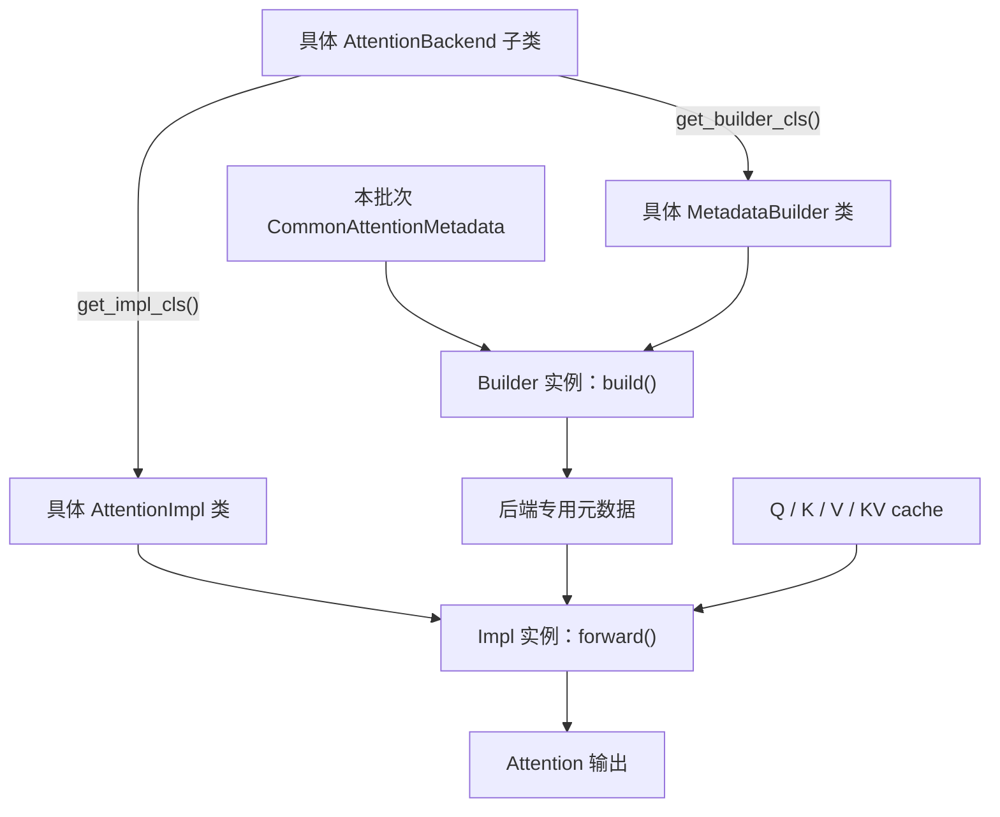

# vllm中， AttentionBackend类的作用

**`AttentionBackend` 是 vLLM 对“一套 Attention 后端方案”的统一接口：声明它支持什么，并告诉框架该用哪个计算实现、哪个元数据构建器。它本身不负责执行 Attention 计算。**

这样，上层框架就不必针对每套 kernel 分别写一条完整调用链。

## 1. 它主要负责什么？

从你贴的代码看，可以分成三类职责：

| 职责 | 对应接口 | 作用 |
|---|---|---|
| 声明能力和限制 | `supports_dtype()`、`supports_head_size()`、`supports_attn_type()` 等 | 描述后端能处理哪些数据类型、head size、Attention 类型和功能 |
| 提供配套实现类 | `get_impl_cls()`、`get_builder_cls()` | 返回实际计算类和元数据构建器类，注意返回的是**类，不是实例** |
| 声明 KV cache 要求 | `get_supported_kernel_block_sizes()`、`supported_kv_cache_layouts()`、`customize_spec()` | 让框架使用符合该后端 kernel 要求的 block size、布局及 cache spec |

其中，[`validate_configuration()`](vllm/v1/attention/backend.py#L276) 将能力检查集中起来，返回**不支持的原因列表**；空列表表示通过这些检查。它不是计算函数，也不是在这里自行选择其他后端。

## 2. 和 `AttentionImpl`、`AttentionMetadataBuilder` 有什么区别？

这几个名字很接近，但分工不同：

- **`AttentionBackend`：描述与入口。**  
  “我支持这些配置；计算请用这个 Impl；准备数据请用这个 Builder。”

- **`AttentionMetadataBuilder`：准备本批次的执行信息。**  
  [`build()`](vllm/v1/attention/backend.py#L682) 将公共的 `CommonAttentionMetadata` 转为后端需要的元数据。例如请求长度、query 起始位置、KV block table，以及后端所需的执行规划信息。

- **`AttentionImpl`：真正执行计算。**  
  [`forward()`](vllm/v1/attention/backend.py#L913) 接收 Q、K、V、KV cache、元数据和输出 buffer，具体子类实现计算路径。MLA 则有自己的 `MLAAttentionImpl` 接口。

可以把关系理解为：



## 3. 为什么大量方法是静态方法或类方法？

因为这些信息主要是**后端级别的属性**，不需要先创建某一层的计算实例才能知道。

例如，框架可以先询问：

```python
backend_cls.supports_dtype(torch.bfloat16)
backend_cls.supports_head_size(128)
impl_cls = backend_cls.get_impl_cls()
builder_cls = backend_cls.get_builder_cls()
```

而具体层的 `num_heads`、`head_size`、`scale` 等参数，则交给 `AttentionImpl` 实例保存，见它的 [`__init__()`](vllm/v1/attention/backend.py#L897)。

**读代码时的关键区分：`Backend` 管“这套方案能不能用、配什么类”，`Builder` 管“这批数据怎么准备”，`Impl` 管“实际怎么算”。**

# 关于flashinfer的backend

有，当前代码中就是 **[`FlashInferBackend`](vllm/v1/attention/backends/flashinfer.py#L431)**，继承自你刚看的 `AttentionBackend`：

```python
class FlashInferBackend(AttentionBackend):
    ...
```

它提供了一套配套类：

| 角色 | FlashInfer 对应类 | 职责 |
|---|---|---|
| 后端描述与入口 | `FlashInferBackend` | 声明能力和限制，提供下面两个类 |
| 元数据构建器 | `FlashInferMetadataBuilder` | 为当前 batch 准备 FlashInfer 所需的元数据 |
| 计算实现 | `FlashInferImpl` | 执行具体 Attention 计算 |

这个对应关系在 [`flashinfer.py:509–515`](vllm/v1/attention/backends/flashinfer.py#L509) 写得很直接：

```python
@staticmethod
def get_impl_cls() -> type["FlashInferImpl"]:
    return FlashInferImpl

@staticmethod
def get_builder_cls() -> type["FlashInferMetadataBuilder"]:
    return FlashInferMetadataBuilder
```

它的后端名称是 **`"FLASHINFER"`**，此外还声明了支持滑动窗口、非因果 Attention，以及 kernel 支持的 KV cache block size 等。

所以，**`AttentionBackend` 是抽象接口，`FlashInferBackend` 就是这套接口的具体实现之一；真正看 FlashInfer 怎么计算，要继续读 `FlashInferImpl`。**
