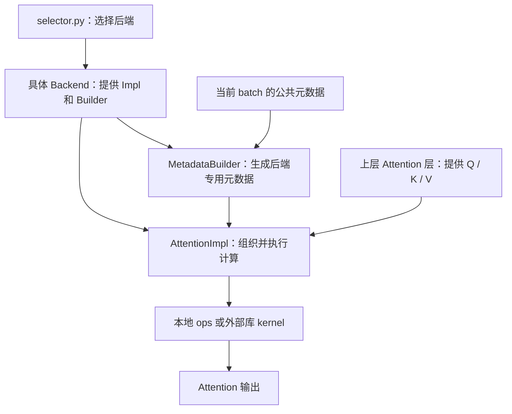

# v1/attention

**`vllm/v1/attention/` 是 vLLM V1 推理引擎的 Attention 执行后端子系统**：统一接口、选择后端、准备执行元数据，再通过具体实现调用计算 kernel。

它解决的是：**同样是 Attention，如何适配不同硬件、kernel 库、KV cache 布局和推理场景，而不让上层模型到处写分支。**

## 目录分工

| 文件 / 目录 | 作用 | 例子 |
|---|---|---|
| [`backend.py`](vllm/v1/attention/backend.py) | 定义各后端共同遵守的接口和公共元数据 | `AttentionBackend`、`AttentionImpl`、`AttentionMetadataBuilder` |
| [`selector.py`](vllm/v1/attention/selector.py#L109) | 提供后端选择入口，延迟导入具体后端 | `get_attn_backend()` |
| `backends/` | 各套后端的具体适配实现 | `FlashInferBackend`、Triton、ROCm 相关后端 |
| `backends/registry.py` | 后端注册相关代码 | 管理后端名称与实现入口 |
| `backends/mla/` | MLA 专用后端实现 | 适配 MLA 的计算和缓存方式 |
| `ops/` | 底层 Attention 算子、kernel 和辅助操作 | Triton decode、prefix prefill、KV cache 写入等 |

注意，**`backends/` 和 `ops/` 不是一回事**：

- **Backend 是“接入方案”**：能力检查、元数据准备、计算路径组织、调用 kernel。
- **Op/kernel 是“具体计算”**：真正执行 Attention 或 KV cache 更新等操作。
- Backend 不一定调用本目录的 `ops/`；也可以调用 FlashInfer 等外部库提供的 kernel。

## 在推理流程中的位置

其中，元数据描述的是“**这一批 token 怎么算**”：每个请求的 query 范围、序列长度、KV cache block table、写入位置等。它不是模型权重。

## 它不等于整个 Transformer Attention 层

这个目录的重点是 **Attention 的执行后端**，不是完整模型结构。不要把它理解成包含所有这些步骤的地方：

- Q/K/V 线性投影；
- RoPE 等位置编码；
- Attention 核心计算；
- 输出线性投影。

**读 FlashInfer 路径时，可以按 `FlashInferBackend → FlashInferMetadataBuilder → FlashInferImpl` 的顺序看：先理解接入契约，再看 batch 数据准备，最后看计算调用。**

