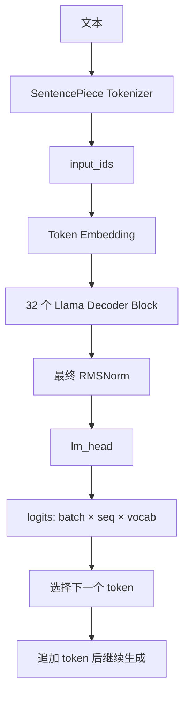

------------
User:

------------

我该怎么入手学习llama2-7b这个经典7b模型的结构？

------------
Assistant:

------------

🧭 最快的入手方式：**先把 `pipeline` 拆开，观察配置、模块、张量形状和一次 forward，再读源码中的一个 Decoder Block**。不要一开始直接阅读全部 7B 权重或整个 `transformers` 工程。

你当前的 `llama2-7b.py`：

```python
pipe = pipeline(
    "text-generation",
    model="hf-models/Llama-2-7b-hf",
    device=0,
    dtype=torch.float16,
)
```

把分词、模型前向、采样、解码全部隐藏了。学习结构时，应改用 `AutoTokenizer` 和 `AutoModelForCausalLM`。

---

## 1. 先建立整体结构

Llama 2 7B 是一个 **decoder-only Transformer**，输入一串 token，输出每个位置的下一个 token 的概率。



单个 Decoder Block 可以先记成：

```text
输入 x
  │
  ├─ RMSNorm
  ├─ Q/K/V 投影
  ├─ RoPE 位置编码
  ├─ Causal Self-Attention
  ├─ 输出投影
  └─ 残差连接
       │
       ├─ RMSNorm
       ├─ SwiGLU MLP
       └─ 残差连接
```

Llama 2 7B 的主要结构参数：

| 项目 | 数值 |
|---|---:|
| Transformer 层数 | 32 |
| hidden size | 4096 |
| attention heads | 32 |
| key/value heads | 32 |
| 每个 head 维度 | 128 |
| MLP 中间维度 | 11008 |
| 词表大小 | 32000 |
| 最大序列长度 | 4096 |
| 位置编码 | RoPE |
| 归一化 | RMSNorm |
| 激活函数 | SiLU / SwiGLU |
| 注意力类型 | Multi-Head Attention |

注意：Llama 2 7B 的 `num_key_value_heads` 和 `num_attention_heads` 都是 32，因此它是普通 MHA；Llama 2 70B 才重点使用 GQA。

---

## 2. 第一个练习：只读取配置，不加载 7B 权重

在项目目录创建一个临时脚本，例如 `inspect_config.py`：

```python
from transformers import AutoConfig

model_path = "hf-models/Llama-2-7b-hf"
config = AutoConfig.from_pretrained(model_path)

fields = [
    "vocab_size",
    "hidden_size",
    "intermediate_size",
    "num_hidden_layers",
    "num_attention_heads",
    "num_key_value_heads",
    "max_position_embeddings",
    "hidden_act",
    "rms_norm_eps",
    "rope_theta",
    "tie_word_embeddings",
]

for field in fields:
    print(f"{field}: {getattr(config, field, None)}")
```

运行：

```bash
python inspect_config.py
```

这一步的目标不是运行模型，而是把配置中的每个字段和架构对应起来：

```text
hidden_size              → 每个 token 的表示维度
num_hidden_layers        → Decoder Block 数量
num_attention_heads     → Q 的 head 数量
num_key_value_heads      → K/V 的 head 数量
intermediate_size        → MLP 中间层维度
max_position_embeddings  → 支持的最大位置长度
```

---

## 3. 第二个练习：显式加载模型并查看模块

```python
import torch
from transformers import AutoModelForCausalLM

model_path = "hf-models/Llama-2-7b-hf"

model = AutoModelForCausalLM.from_pretrained(
    model_path,
    torch_dtype=torch.float16,
)
model = model.cuda().eval()

print(model)
```

重点观察这些模块：

```text
model.model.embed_tokens
model.model.layers
model.model.layers[0].input_layernorm
model.model.layers[0].self_attn.q_proj
model.model.layers[0].self_attn.k_proj
model.model.layers[0].self_attn.v_proj
model.model.layers[0].self_attn.o_proj
model.model.layers[0].post_attention_layernorm
model.model.layers[0].mlp.gate_proj
model.model.layers[0].mlp.up_proj
model.model.layers[0].mlp.down_proj
model.model.norm
model.lm_head
```

可以直接打印第一层的权重形状：

```python
layer = model.model.layers[0]

for name, parameter in layer.named_parameters():
    print(f"{name:45} {tuple(parameter.shape)}")
```

你应看到类似：

```text
self_attn.q_proj.weight       (4096, 4096)
self_attn.k_proj.weight       (4096, 4096)
self_attn.v_proj.weight       (4096, 4096)
self_attn.o_proj.weight       (4096, 4096)

mlp.gate_proj.weight          (11008, 4096)
mlp.up_proj.weight            (11008, 4096)
mlp.down_proj.weight          (4096, 11008)
```

这样可以直观看到：

- Attention 每层有四个主要投影；
- MLP 不是普通的两层网络，而是三个投影；
- MLP 的中间维度从 4096 扩展到 11008，再压回 4096。

---

## 4. 第三个练习：观察一次 forward 的张量形状

```python
import torch
from transformers import AutoModelForCausalLM, AutoTokenizer

model_path = "hf-models/Llama-2-7b-hf"
device = "cuda"

tokenizer = AutoTokenizer.from_pretrained(model_path)
model = AutoModelForCausalLM.from_pretrained(
    model_path,
    torch_dtype=torch.float16,
).to(device).eval()

inputs = tokenizer(
    "The structure of Llama 2 is",
    return_tensors="pt",
).to(device)

with torch.inference_mode():
    outputs = model(
        **inputs,
        output_hidden_states=True,
        use_cache=False,
    )

print("input_ids:", inputs["input_ids"].shape)
print("logits:", outputs.logits.shape)
print("number of hidden states:", len(outputs.hidden_states))

for index, hidden_state in enumerate(outputs.hidden_states):
    print(index, tuple(hidden_state.shape))
```

假设输入有 7 个 token，典型形状是：

```text
input_ids:  [1, 7]
hidden:     [1, 7, 4096]
logits:     [1, 7, 32000]
```

其中：

```text
batch = 1
sequence length = 7
hidden size = 4096
vocabulary size = 32000
```

`outputs.logits[0, -1]` 表示最后一个输入位置对下一个 token 的预测：

```python
next_token_logits = outputs.logits[0, -1]
top_values, top_ids = torch.topk(next_token_logits.float(), k=10)

for token_id, score in zip(top_ids.tolist(), top_values.tolist()):
    token = tokenizer.decode([token_id])
    print(repr(token), score)
```

这一步会把“模型输出一个文本”转化成更基础的事实：

```text
最后一个位置
    → 一个长度为 32000 的向量
    → 每个词表 token 一个分数
    → 选择或采样一个 token
```

---

## 5. 必须掌握的三个核心公式

### RMSNorm

Llama 使用 RMSNorm，而不是原始 Transformer 常见的 LayerNorm：

$$
\operatorname{RMSNorm}(x)
=
\frac{x}{\sqrt{\operatorname{mean}(x^2)+\epsilon}}
\odot w
$$

重点：

- 不减均值；
- 只有缩放参数；
- Llama 使用 pre-norm 结构；
- Attention 和 MLP 前都会先归一化。

### SwiGLU

Llama 的 MLP 大致是：

$$
\operatorname{MLP}(x)
=
W_{\text{down}}
\left(
\operatorname{SiLU}(W_{\text{gate}}x)
\odot
W_{\text{up}}x
\right)
$$

对应代码中的：

```text
gate_proj
up_proj
down_proj
```

它不是：

```text
down(relu(up(x)))
```

而是两个并行投影，其中一个经过 SiLU 后与另一个逐元素相乘。

### Causal Self-Attention

注意力的核心形式：

$$
\operatorname{Attention}(Q,K,V)
=
\operatorname{softmax}
\left(
\frac{QK^\top}{\sqrt{d}}
+
\text{causal mask}
\right)V
$$

Llama 还会对 Q 和 K 应用 RoPE。因果 mask 保证当前位置不能读取未来 token。

---

## 6. 建议按这个顺序读源码

不要从 `pipeline` 的实现开始。建议顺序：

### 第一阶段：配置

阅读：

```text
transformers/models/llama/configuration_llama.py
```

目标：

- 明白每个配置字段；
- 搞清楚 7B、13B、70B 主要差在哪里；
- 特别关注 hidden size、层数、head 数和 MLP 维度。

### 第二阶段：模型结构

阅读：

```text
transformers/models/llama/modeling_llama.py
```

优先找这些类：

```text
LlamaForCausalLM
LlamaModel
LlamaDecoderLayer
LlamaAttention
LlamaMLP
LlamaRMSNorm
LlamaRotaryEmbedding
```

推荐顺序：

```text
LlamaForCausalLM
    → LlamaModel
        → LlamaDecoderLayer
            → LlamaAttention
            → LlamaMLP
```

### 第三阶段：生成过程

最后再读：

```text
model.generate(...)
```

重点理解：

- 为什么每轮只需要最后一个位置的 logits；
- `past_key_values` / KV cache 是什么；
- 为什么生成第一个 token 慢，后续 token 相对快；
- temperature、top-k、top-p 如何改变 token 选择。

---

## 7. 一个很有效的学习实验：禁用组件

你可以依次做这些实验，观察输出变化：

1. 把输入改成一个 token、两个 token、较长文本；
2. 打印每层 hidden state 的范数；
3. 比较第 0 层和第 31 层的表示；
4. 关闭 `use_cache`，比较生成速度；
5. 改变 `max_new_tokens`；
6. 用 greedy decoding 和 sampling 比较结果；
7. 对同一个句子替换一个 token，观察最后 logits 如何变化。

例如观察每层表示的范数：

```python
with torch.inference_mode():
    outputs = model(
        **inputs,
        output_hidden_states=True,
        use_cache=False,
    )

for index, hidden_state in enumerate(outputs.hidden_states):
    norm = hidden_state.float().norm(dim=-1).mean().item()
    print(f"layer {index:2}: mean norm = {norm:.4f}")
```

这不能直接告诉你“某一层学会了什么语义”，但能帮助你建立真实的张量流动模型。

---

## 8. 不要直接从 7B 模型学习所有细节

7B 模型适合观察真实工程结构，但不适合手算所有细节。建议同时写一个极小的 Transformer：

```text
vocab_size = 100
hidden_size = 32
num_layers = 2
num_heads = 4
sequence_length = 16
```

用小模型手动实现：

1. embedding；
2. RMSNorm；
3. Q/K/V；
4. causal mask；
5. RoPE；
6. attention；
7. SwiGLU；
8. residual；
9. logits；
10. greedy generation。

然后把小模型的模块名称和 Llama 2 的模块一一对应：

| 小模型 | Llama 2 |
|---|---|
| token embedding | `embed_tokens` |
| attention Q | `q_proj` |
| attention K | `k_proj` |
| attention V | `v_proj` |
| attention output | `o_proj` |
| MLP gate | `gate_proj` |
| MLP up | `up_proj` |
| MLP down | `down_proj` |
| final normalization | `model.norm` |
| vocabulary projection | `lm_head` |

这是理解模型结构最稳妥的方式：**小模型负责理解算法，Llama 2 负责理解真实工程和真实规模。**

---

## 推荐的实际学习路线

```text
第 1 步：读取 config，记住 32 / 4096 / 11008 / 32k
第 2 步：打印 model.named_modules()
第 3 步：观察一次 forward 的输入、hidden、logits 形状
第 4 步：只读懂一个 LlamaDecoderLayer
第 5 步：理解 RMSNorm、RoPE、SwiGLU、causal attention
第 6 步：理解 logits 如何变成下一个 token
第 7 步：理解 KV cache
第 8 步：实现一个 2 层、32 hidden 的迷你版本
第 9 步：再回头读 Llama 2 论文和 Hugging Face 实现
```

你当前项目最适合的第一个动作是：**保留现有 `llama2-7b.py` 作为推理脚本，另外写一个只负责 `config + module + tensor shape` 的 `inspect_llama.py`，不要马上修改推理逻辑。**

如果当前虚拟环境仍然出现 `PyTorch was not found`，先安装 `requirements.txt` 中的 `torch`；没有 PyTorch 时只能读取部分配置，不能完成模型 forward。

