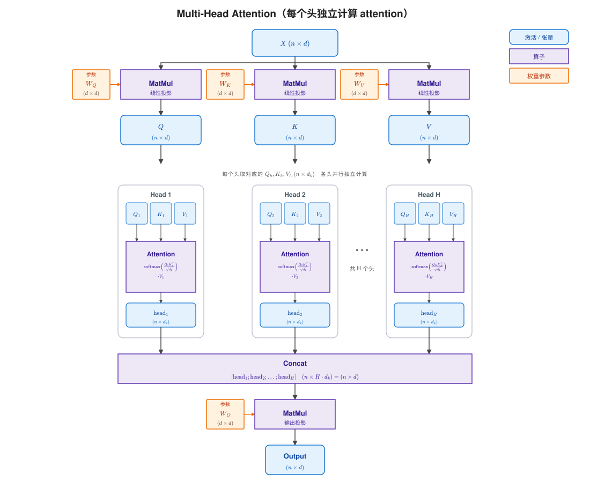

## LLaMA Attention

假设Batch size （$B$）、头数（$H$）均为1。
输入序列：$X=[x_1,x_2,\dots,x_n]\in\mathbb{R}^{n\times d}$

- **$n$**：序列长度，也就是 token 的个数；
- **$d$**：模型隐藏维度，也就是每个 token 向量的维度（hidden size）。LLaMA2-7b的$d$=4096

### 投影

LLaMA2-7b的$W_Q$, $W_K$, $W_V$都是$d \times d$的矩阵。
投影得到：

$$
Q=XW_Q,\quad K=XW_K,\quad V=XW_V \\
Q\in\mathbb{R}^{n\times d},\quad
K\in\mathbb{R}^{n\times d},\quad
V\in\mathbb{R}^{n\times d}
$$


#### 投影算子融合机会
- 未融合时，假设$B$=1，$H$=1
   - prefill阶段，执行3次独立的矩阵x矩阵
   - decode阶段，执行3次独立的向量x矩阵
   - transformers库这类简单实现中，QKV投影矩阵是三个独立的nn.Linear
```python
        self.q_proj = nn.Linear(
            config.hidden_size, config.num_attention_heads * self.head_dim, bias=config.attention_bias
        )
        self.k_proj = nn.Linear(
            config.hidden_size, config.num_key_value_heads * self.head_dim, bias=config.attention_bias
        )
        self.v_proj = nn.Linear(
            config.hidden_size, config.num_key_value_heads * self.head_dim, bias=config.attention_bias
        )
```
- 融合时，由于$X$相同，可以把$W_Q, W_K, W_V$拼成一个矩阵，做一次大矩阵（prefill）/向量（decode）x矩阵。
   - vLLM中，QKV投影矩阵需要合并实现
```python
        self.qkv_proj = QKVParallelLinear(
            hidden_size=hidden_size,
            head_size=self.head_dim,
            total_num_heads=self.total_num_heads,
            total_num_kv_heads=self.total_num_kv_heads,
            bias=bias,
            quant_config=quant_config,
            prefix=f"{prefix}.qkv_proj",
        )
```
```
W_QKV = [ W_Q | W_K | W_V ]   形状 4096 × 12288

                 c=0 ... 4095              c=4096 ... 8191           c=8192 ... 12287
              ┌──── W_Q，4096列 ────┐  ┌──── W_K，4096列 ────┐  ┌──── W_V，4096列 ────┐
i=0           [ WQ[0,0] ... WQ[0,4095] | WK[0,0] ... WK[0,4095] | WV[0,0] ... WV[0,4095] ]
i=1           [ WQ[1,0] ... WQ[1,4095] | WK[1,0] ... WK[1,4095] | WV[1,0] ... WV[1,4095] ]
i=2           [ WQ[2,0] ... WQ[2,4095] | WK[2,0] ... WK[2,4095] | WV[2,0] ... WV[2,4095] ]
...
i=4095        [ WQ[4095,0] ... WQ[4095,4095] | WK[4095,0] ... WK[4095,4095] | WV[4095,0] ... WV[4095,4095] ]
```

### 单头注意力

$$
\text{Attn}(Q,K,V) =
\text{softmax}\left(\frac{QK^T}{\sqrt{d}}+M\right)V
$$

其中
$$
\mathrm{Attn}(Q,K,V)\in\mathbb{R}^{n\times d}
$$

$M$ 是 causal mask：
$$
M_{ij}=
\begin{cases}
0, & j\le i\\
-\infty, & j>i
\end{cases}
$$

逻辑上，$M\in\mathbb{R}^{n\times n}$；真实实现中，attention 是带 batch 和多头的：

$$
Q,K\in\mathbb{R}^{B\times H\times n\times d} \\
QK^T\in\mathbb{R}^{B\times H\times n\times n}
$$

此时 mask 不需要真的存 $B\times H\times n\times n$ 份，通常存成：
$$
M\in\mathbb{R}^{1\times 1\times n\times n}
$$

### $QK^T$的含义

$QK^T\in\mathbb{R}^{n\times n}$

- **第 $i$ 行**：第 $i$ 个 query token 对所有 key token 的打分；
- **第 $j$ 列**：所有 query token 对第 $j$ 个 key token 的打分；
- **元素 $(i,j)$**：第 $i$ 个 query向量 与第 $j$ 个 key向量 的相似度分数：$(QK^T)_{ij}=q_i^Tk_j$

```text
              key j →
           k1   k2   k3  ...  kn
        ┌────┬────┬────┬────┬────┐
   q1   │s11 │s12 │s13 │ ...│s1n │  ← 第 1 个 query 对全部 key 的分数
        ├────┼────┼────┼────┼────┤
   q2   │s21 │s22 │s23 │ ...│s2n │
        ├────┼────┼────┼────┼────┤
   q3   │s31 │s32 │s33 │ ...│s3n │
        ├────┼────┼────┼────┼────┤
  ...   │ ...│ ...│ ...│ ...│ ...│
        ├────┼────┼────┼────┼────┤
   qn   │sn1 │sn2 │sn3 │ ...│snn │
        └────┴────┴────┴────┴────┘
         ↑
      第 j 列：所有 query 对第 j 个 key 的分数
```
其中$s_{ij}=q_i^Tk_j$

### Causal Mask

LLaMA 的 causal mask 让 $j>i$ 的位置变成 $-\infty$：
```
        k1   k2   k3   k4
   q1 │ s11  -∞   -∞   -∞ │
   q2 │ s21  s22  -∞   -∞ │
   q3 │ s31  s32  s33  -∞ │
   q4 │ s41  s42  s43  s44│
```

- 第 $i$ 行只有前 $i$ 列有效；
- 第 $i$ 个 query 只能看到 $j\le i$ 的 key。

变成$-\infty$后， 再经过softmax ，这些位置的权重精确为 0。

### Softmax归一化

softmax 的输入被称为logits。
除以$\sqrt{d}$是为了把点积的方差从$d$拉回1，防止 softmax 饱和、梯度消失和数值溢出。

归一化通用形式：
$\alpha_i=\frac{f(z_i)}{\sum_j f(z_j)}$
- $f(z)=z$：普通归一化（保持比例）
- $f(z)=e^z$：softmax归一化（放大差异）
- $f(z)=\max(z,0)$：ReLU 归一化

示例：$z=(1,2,3)$

- 普通归一化：$(1/6,2/6,3/6)=(0.167,0.333,0.500)$，比例仍是 $1:2:3$；
- softmax：$(0.090,0.245,0.665)$，比例变成 $1:2.7:7.4$，差距被拉大。

### QKV和Attention的含义


| 符号 | 角色 |
|---|---|
| $X\in\mathbb{R}^{n\times d}$ | 输入序列$X$的hidden state |
| $Q$ | 当前 token 发出的**查询** |
| $K$ | 每个 token 提供的**索引/标签** |
| $V$ | 每个 token 携带的**实际内容** |
| $\mathrm{Attn}(Q,K,V)\in\mathbb{R}^{n\times d}$ | **行 $i$**：第 $i$ 个 token 经过注意力后的**新表示**。**列**：隐藏特征维，每个 token 一个 $d$ 维向量。|

- Attention的输出和输入$X$形状完全相同，可以做残差。
- 经过Attention后，行与行之间不再独立，每一行都把其它行的$V$按权重加起来了。

### 多头注意力（MHA）

| 模型版本 | 注意力头数 (Attention Heads) | KV 头数 (KV Heads) | 每个头维度 ($d_{\text{head}}$) | 备注 |
| :--- | :--- | :--- | :--- | :--- |
| **Llama 2 7B** | **32** | 32 | **128** | 标准多头注意力 (MHA) |
| **Llama 2 13B** | **40** | 40 | **128** | 标准多头注意力 (MHA) |
| **Llama 2 70B** | **64** | **8** | **128** | 分组查询注意力 (GQA) |


Transformers的Llama 2 7B实现中，多头在投影阶段是经过同一个`q_proj、k_proj、v_proj`矩阵乘法，
经过view + transpose改变shape实现。
```
=== prefill attention ===
hidden_states: shape=(1, 4, 4096), dtype=torch.float32
position_ids: shape=(1, 4), dtype=torch.int64
attention_mask: shape=(1, 1, 4, 4), dtype=torch.float32
attention_mask[0, 0]: [[0.0, -inf, -inf, -inf], [0.0, 0.0, -inf, -inf], [0.0, 0.0, 0.0, -inf], [0.0, 0.0, 0.0, 0.0]]
cache tokens before attention: 0

=== Python-level operator trace ===
[01] LlamaAttention.forward
  [02] q_proj: Linear, input=(shape=(1, 4, 4096), dtype=torch.float32), output=(shape=(1, 4, 4096), dtype=torch.float32)
  [03] q_proj: view + transpose: output=(shape=(1, 32, 4, 128))
  [04] k_proj: Linear, input=(shape=(1, 4, 4096), dtype=torch.float32), output=(shape=(1, 4, 4096), dtype=torch.float32)
  [05] k_proj: view + transpose: output=(shape=(1, 32, 4, 128))
  [06] v_proj: Linear, input=(shape=(1, 4, 4096), dtype=torch.float32), output=(shape=(1, 4, 4096), dtype=torch.float32)
  [07] v_proj: view + transpose: output=(shape=(1, 32, 4, 128))
```

在投影阶段，多头注意力本质和单头没区别
```
W_Q，数学形状 4096 × 4096
行 i = 输入维度；列 c = 输出维度

                c=0 ... 127                  c=128 ... 255            ...         c=3968 ... 4095
        ┌────────── 头1 ─────────────┐ ┌────────── 头2 ─────────────┐     ┌──────────── 头32 ─────────────┐
i=0     [ WQ[0,0]   ... WQ[0,127]    | WQ[0,128]   ... WQ[0,255]    | ... | WQ[0,3968]   ... WQ[0,4095]   ]
i=1     [ WQ[1,0]   ... WQ[1,127]    | WQ[1,128]   ... WQ[1,255]    | ... | WQ[1,3968]   ... WQ[1,4095]   ]
i=2     [ WQ[2,0]   ... WQ[2,127]    | WQ[2,128]   ... WQ[2,255]    | ... | WQ[2,3968]   ... WQ[2,4095]   ]
...
i=4095  [ WQ[4095,0]... WQ[4095,127] | WQ[4095,128]... WQ[4095,255] | ... | WQ[4095,3968]...WQ[4095,4095] ]
        └──── W_Q^(1) 4096×128 ──────┘ └────── W_Q^(2) 4096×128 ────┘     └────── W_Q^(32) 4096×128 ──────┘
```

对第 $h$ 个头（$h=1,\dots,H$）：

$$
W_Q^{(h)}\in\mathbb R^{d\times d_k},\qquad
W_K^{(h)}\in\mathbb R^{d\times d_k},\qquad
W_V^{(h)}\in\mathbb R^{d\times d_v}
$$

$$
Q_h=XW_Q^{(h)}\in\mathbb R^{n\times d_k},\\
K_h=XW_K^{(h)}\in\mathbb R^{n\times d_k},\\
V_h=XW_V^{(h)}\in\mathbb R^{n\times d_v}.
$$

每个头维度通常为：$d_k=d_v=\frac{d}{H}$

第 $h$ 个头的输出：

$$
\text{head}_h
=
\text{softmax}\left(
\frac{Q_hK_h^\top}{\sqrt{d_k}}+M
\right)V_h
\in\mathbb R^{n\times d_v}.
$$

其中 $M$ 是 causal mask。

多头拼接后：

$$
\text{MultiHead}(X)
=
\text{Concat}(\text{head}_1,\dots,\text{head}_H)W_O \in\mathbb R^{n\times d}
$$



输出投影$W_O$：让不同 head 的输出可以线性混合，形成新的特征。没有
$W_O$ ，各 head 的信息只是简单拼接，缺少跨 head 的线性融合。

如果有 RoPE，则先对每个头的 $Q_h,K_h$ 做位置旋转，再算 attention：
$$
\text{head}_h
=
\text{softmax}\left(
\frac{\text{RoPE}(Q_h)\text{RoPE}(K_h)^T}{\sqrt{d_k}}+M
\right)V_h
$$

### 多头相比单头，理论计算量相同

从算法复杂度的角度看，对于长度为 $n$、维度为 $d$ 的序列：
*   **单头注意力的时间复杂度**：$\Theta(n^2 \cdot d)$。
*   **多头注意力的时间复杂度**：假设有 $H$ 个头，每个头维度为 $d_k = d/H$。每个头的计算量为 $\Theta(n^2 \cdot d_k)$，总和为 $H \cdot \Theta(n^2 \cdot d_k) = \Theta(n^2 \cdot H \cdot d_k) = \Theta(n^2 \cdot d)$。

两者在时间复杂度上是**同一个量级**。

实际实现性能对比：待分析

### RoPE

#### 没有RoPE的后果

$$
\text{score}_{ij}
=
\frac{q_i^T k_j}{\sqrt{d_k}}
=
\frac{(x_iW_Q)^T(x_jW_K)}{\sqrt{d_k}}
$$

这个分数**只依赖 \(x_i\) 和 \(x_j\) 的内容，完全不依赖 \(i\) 和 \(j\)**。位置 \(i,j\) 没有以任何形式进入公式。

##### Attention 是置换等变的

假设没有 causal mask，对输入做任意置换 \(P\)（打乱 token 顺序）：

\[
X'=PX
\]

那么：

\[
Q'=PXW_Q=PQ
\]

\[
K'=PK,\quad V'=PV
\]

代入注意力：

\[
\text{Attn}(Q',K',V')
=
\text{softmax}\left(\frac{PQK^TP^T}{\sqrt{d_k}}\right)PV
=
P\cdot\text{softmax}\left(\frac{QK^T}{\sqrt{d_k}}\right)V
=
P\cdot\text{Attn}(Q,K,V)
\]

[逐行softmax的置换等变性证明](./softmax_permutation_equivariance.md)

即：

\[
\boxed{
\text{Attn}(PX)=P\cdot\text{Attn}(X)
}
\]

这叫**置换等变**：打乱输入顺序，输出只是被同样打乱，内容完全不变。

##### 单层 attention、无RoPE、有Causal mask，只取最后位置，结果相同


```
        k1   k2   k3   k4
   q1 │ s11  -∞   -∞   -∞ │
   q2 │ s21  s22  -∞   -∞ │
   q3 │ s31  s32  s33  -∞ │
   q4 │ s41  s42  s43  s44│
```

#### 二维向量的旋转矩阵

假设有一个二维向量：$\mathbf{v} = (x, y)$，向量长度是$r = \sqrt{x^2+y^2}$。

现在把这个向量绕原点逆时针旋转 $\theta$ 角，得到新向量：$\mathbf{v}' = (x', y')$


旋转过程中有两个重要性质：
1. **长度不变**：$|\mathbf{v}'| = |\mathbf{v}| = r$。
2. **方向变了**：原来的角度加上 $\theta$，变成新的角度。

##### 旋转公式推导

原来的向量可以写成：$x = r\cos\alpha$, $y = r\sin\alpha$，
其中 $\alpha$ 是原向量和 x 轴的夹角。

旋转 $\theta$ 后，新角度是：$\alpha + \theta$。

所以，
$x' = r\cos(\alpha+\theta)$，$y' = r\sin(\alpha+\theta)$

用三角和角公式展开：

$$
x' = r(\cos\alpha\cos\theta - \sin\alpha\sin\theta)
y' = r(\sin\alpha\cos\theta + \cos\alpha\sin\theta)
$$

代入：$x = r\cos\alpha,\quad y = r\sin\alpha$

得到：

$$
x' = x\cos\theta - y\sin\theta
y' = x\sin\theta + y\cos\theta
$$

这就是二维旋转公式。

##### 写成矩阵形式

$$
\begin{pmatrix}
x' \\
y'
\end{pmatrix}
=
\begin{pmatrix}
\cos\theta & -\sin\theta \\
\sin\theta & \cos\theta
\end{pmatrix}
\begin{pmatrix}
x \\
y
\end{pmatrix}
$$

#### RoPE核心原理

LLaMA 中的 RoPE (Rotary Position Embedding) 通过一种**旋转**操作将位置信息融入注意力机制。它的核心思想是：对 Query (Q) 和 Key (K) 向量的维度进行成对旋转，旋转的角度由该 token 的**绝对位置**决定。这样一来，当计算两个 token 的 Q 和 K 的点积时，其结果会自然地只依赖于它们的**相对位置**。

RoPE 会把一个高维向量拆成很多二维子空间，例如：

```text
q = [ q0, q1, q2, q3, q4, q5, ... ]

可以看成：

(q0, q1)  → 一个二维平面
(q2, q3)  → 另一个二维平面
(q4, q5)  → 另一个二维平面
...
```

对每一对维度做旋转：

$$
\begin{pmatrix}
q'_{2i} \\
q'_{2i+1}
\end{pmatrix}
=
\begin{pmatrix}
\cos(m\theta_i) & -\sin(m\theta_i) \\
\sin(m\theta_i) & \cos(m\theta_i)
\end{pmatrix}
\begin{pmatrix}
q_{2i} \\
q_{2i+1}
\end{pmatrix}
$$

其中：

- $m$ 是 token 的位置；
- $\theta_i$ 是这一对维度对应的固定频率；
- $m\theta_i$ 就是旋转角度。
- $\theta_i = 10000^{-2i/d}$（LLaMA 3将10000调为500000，支持更长的上下文）

TODO: 相对位置

#### LLaMA 中的具体实现：`rotate_half` 风格

在实际的 LLaMA 代码实现中，为了高效计算，通常不会显式地构造旋转矩阵，而是采用一种称为 **`rotate_half`** 的向量化操作。

假设一个头维度 `head_dim` 为 \(d\) 的向量 `x`，其整体计算可以简洁地表示为：
\[
\text{RoPE}(x) = x \odot \cos + \text{rotate\_half}(x) \odot \sin
\]
其中，\(\odot\) 表示逐元素乘法。关键在于 `rotate_half` 函数的操作：

1. **分割**：将向量 `x` 沿最后一维**平均分成两半**，得到前半部分 \(x_{\text{first}}\) 和后半部分 \(x_{\text{second}}\)。
   \[
   x = [x_{\text{first}} \mid x_{\text{second}}]
   \]
2. **构造旋转**：`rotate_half(x)` 的结果是将**后半部分取负，前半部分保持原样，然后交换位置**。
   \[
   \text{rotate\_half}(x) = [-x_{\text{second}} \mid x_{\text{first}}]
   \]
   这个操作等价于对向量的每一个二维子空间进行 90 度的旋转，再与预先计算好的 `cos` 和 `sin` 表相乘，就能组合出任意角度的旋转效果。

这种实现方式可以完全利用现有的矩阵乘法和逐元素运算来完成，无需编写特殊的内核，因此在 LLaMA、GPT-NeoX、Mistral 等模型中被广泛采用。

